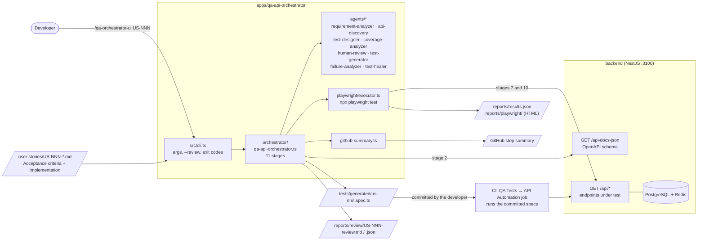
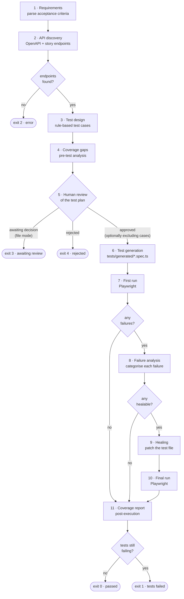

# QA API Orchestrator

Turns a user story (`user-stories/US-NNN-*.md`) into a Playwright API test suite for the
backend. It reads the story's acceptance criteria and the backend's OpenAPI schema, designs
test cases, has a person review the plan, generates the spec, runs it against the live
backend, heals test-side failures and reports requirement coverage.

Every stage is **deterministic**: markdown parsing, rule-based design, templates and pattern
matching. No stage calls a language model, so the same story and API always give the same tests.
`src/llm/client.ts` (Anthropic SDK) and `prompts/*.md` are in the repo but are not used by
any stage.

```
npm run qa ../../user-stories/US-001-search-by-flight-number.md
```

---

## Architecture

### Where it fits



The orchestrator runs **locally**, where a person can review the test plan. CI never generates
tests: the developer commits the generated spec, and the *API Automation* job in
`.github/workflows/qa-tests.yml` runs every committed spec against a freshly started backend.
Specs for stories the change touches run first.

### The 11 stages



Stages 8–10 run only when the first run has failures that look like test-side problems. In
every completed run, the post-execution coverage report (stage 11), the terminal summary and
the GitHub step summary are produced.

---

## Stages

| # | Stage | Module | Method | Produces (`OrchestratorState`) |
|---|-------|--------|--------|------------------------------|
| 1 | Requirements | `agents/requirement-analyzer.ts` | Markdown parse | `requirements` |
| 2 | API discovery | `agents/api-discovery.ts` | OpenAPI fetch + story endpoints | `apiContract` |
| 3 | Test design | `agents/test-designer.ts` | Rules per requirement type | `testDesign` |
| 4 | Coverage gaps | `agents/coverage-analyzer.ts` | Requirement ↔ test mapping | `preCoverage` |
| 5 | Human review | `agents/human-review.ts` | Person approves / excludes / rejects | `review`, `stoppedAtReview` |
| 6 | Test generation | `agents/test-generator.ts` | Templates | `generatedTestPath` |
| 7 | First run | `playwright/executor.ts` | `npx playwright test` | `firstRun` |
| 8 | Failure analysis | `agents/failure-analyzer.ts` | Pattern rules | `analysis` |
| 9 | Healing | `agents/test-healer.ts` | Regex patches | `healAttempted` |
| 10 | Final run | `playwright/executor.ts` | `npx playwright test` | `finalRun` |
| 11 | Coverage report | `agents/coverage-analyzer.ts` | Requirement ↔ result mapping | `coverageReport` |

### 1 · Requirements

Reads the story's `## Acceptance criteria` section. Every bullet becomes a requirement with an
ID (`REQ-001-01`, `REQ-001-02`, …) and a type taken from keywords in its text:

| Type | Keywords |
|------|----------|
| `negative` | invalid, error, missing, reject, fail |
| `validation` | format, validat, boundary, type, pattern |
| `schema` | schema, field, structure, json, array |
| `functional` | anything else |

If no bullet is negative, it adds *"Missing required parameters must return HTTP 400"*. If
none is a schema requirement, it adds *"Response body must be valid JSON with documented
fields"*. So every story gets at least one of each.

### 2 · API discovery

Fetches the backend's OpenAPI schema from `OPENAPI_URL` (default
`${API_BASE_URL}/api-docs-json`), and collects the endpoints written as `` `GET /api/...` `` in
the story's `## Implementation` section. It keeps the schema paths that match one of them,
exactly or by prefix. If the story names none, every path is used. For each operation it
records the method and the query parameters (name, required, type). If no endpoint is found,
the run stops with exit code 2. The usual causes are a backend that isn't running, or a story
with no `## Implementation` endpoints.

### 3 · Test design

Builds test cases from the requirements and the API contract:

- **Functional:** a happy-path request with example values from the story's inline code
  (`6E 5321`, `BLR`, `2026-09-30`). Designed as "expects 200", but the generated test accepts
  any status below 500, so 404 (no data) and 503 (not configured) also pass.
- **Negative:** one test per required parameter, sent without it. Expects 400.
- **Validation:** an invalid value for parameters with known formats (e.g. `from=X`,
  `iata=12345`). Expects 400.
- **Schema:** for endpoints that take parameters, checks the success response is valid JSON.
  The generator can also assert named fields (`expectedFields`), but the designer doesn't set
  them yet.

Each test case is linked to one requirement.

### 4 · Coverage gaps (pre-test)

Checks the planned tests against the requirements *before* anything is generated, and
reports a coverage percentage and gaps of four kinds:

| Gap | Meaning |
|-----|---------|
| `no_test_mapped` | A requirement no test case covers |
| `no_negative_counterpart` | A functional requirement in a story with no negative test at all |
| `no_validation_boundary` | A validation requirement whose tests don't try a boundary or invalid value |
| `no_schema_assertion` | An endpoint with no schema test |

### 5 · Human review

A person signs off on the test plan before any test is generated or run. The reviewer sees:
- the coverage %
- every gap
- the planned test cases with their IDs

The reviewer then chooses one of:
- **Approve.**
- **Approve but exclude test case IDs.** Coverage is recalculated without them.
- **Reject.** A comment is required, and the run stops with exit code 4. Nothing is generated.

| Mode | When | How |
|------|------|-----|
| `interactive` | Default in a terminal | Prompts in the terminal. If input closes, the run aborts with exit 2 |
| `file` | Default without a terminal (agents, CI) | Writes `reports/review/<ID>-review.md` (the plan) and `<ID>-review.json` (`"decision": "pending"`), then exits 3. The next run reads the recorded decision |
| `auto` | Only when asked for | Skips the review, recorded as `auto` |

Set the mode with `--review=<mode>` or `QA_REVIEW`. The reviewer name comes from `QA_REVIEWER`,
otherwise `git config user.name`, otherwise the OS user name. The decision file carries a `planHash`. If the story or API changes the plan after the
review, the old decision is ignored and a new review is requested. `reports/` is gitignored,
so decisions stay on the machine that made them.

`/qa-orchestrator-ui` handles exit 3 by showing the plan and asking the user. It never
approves, excludes or rejects on the user's behalf.

### 6 · Test generation

Renders the approved test cases into `tests/generated/<us-nnn>.spec.ts`, one Playwright API
test per case. Commit this file to add the story's tests to CI.

### 7 · First run

Runs the generated spec with `npx playwright test`, using this package's
`playwright.config.ts`, against `API_BASE_URL`. The results are read from
`reports/results.json`. Retried tests are counted once. An HTML report is written to
`reports/playwright/`. If everything passes, it goes straight to stage 11.

### 8 · Failure analysis

Sorts each failure by its error, expected and actual values:

| Pattern | Category | Healable |
|---------|----------|----------|
| `ECONNREFUSED`, network error, timeout | `ENVIRONMENT_FAILURE` (backend not reachable) | no |
| Expected 400, got 2xx | `TEST_BUG` (the parameter is optional) | yes |
| Expected 200, got 400 | `TEST_BUG` (wrong request parameters) | yes* |
| Expected 200, got 404 | `TEST_DATA_ISSUE` (no matching data) | yes |
| Any 5xx | `APPLICATION_BUG` (unhandled server error) | no |
| `undefined` property / `TypeError` | `TEST_BUG` (field missing from the response) | yes |
| anything else | `APPLICATION_BUG` | no |

\* Marked healable, but stage 9 has no automatic fix for it (see below).

If nothing is healable, it goes to stage 11. What's left are application bugs for a person to
look at.

### 9 · Healing

Patches the generated spec for each healable failure:
- **Optional parameter or absent data:** that test's strict `toBe(<status>)` becomes
  `toBeLessThan(500)`.
- **Missing field:** `expect(body.x).toBeDefined()` becomes `expect(body?.x).toBeDefined()`.
- **Wrong request parameters:** left unchanged, because the right values can't be known
  automatically.

The healed file overwrites the generated one.

### 10 · Final run

Runs the healed spec again. Its result is the run's final result.

### 11 · Coverage report (post-execution)

Combines the requirements, the test design and the final results. A requirement counts as
**covered** only if it has at least one test and all its tests passed. The report shows:
- coverage per requirement type
- requirements with no test at all
- pre-test gaps that still apply (requirement untested, or a related test failed)
- a coverage score (covered ÷ all requirements) with a verdict: **FULL** (100%), **PARTIAL**
  (≥ 70%) or **INSUFFICIENT** (< 70%)

It's printed after the run summary, and written to the GitHub step summary when
`GITHUB_STEP_SUMMARY` is set. The step summary also shows a run stopped at review (⏸️ awaiting,
⛔ rejected).

---

## Usage

```
cd apps/qa-api-orchestrator
npm run qa <path-to-story.md> [--review=interactive|file|auto]
```

Or from Claude Code: `/qa-orchestrator-ui US-001`. The backend must be running (see the root
README).

### Exit codes

| Code | Meaning |
|------|---------|
| 0 | All tests passed |
| 1 | Tests still failing after healing |
| 2 | Error: story not found, no endpoints, invalid review mode or decision file, aborted review |
| 3 | Awaiting human review (file mode): record the decision and run again |
| 4 | The reviewer rejected the test plan; nothing was generated |

### Environment

| Variable | Default | Used for |
|----------|---------|----------|
| `API_BASE_URL` | `http://localhost:3100` | Backend under test (stages 2, 7, 10) |
| `OPENAPI_URL` | `${API_BASE_URL}/api-docs-json` | OpenAPI schema (stage 2) |
| `QA_REVIEW` | `interactive` in a terminal, otherwise `file` | Review mode (stage 5) |
| `QA_REVIEWER` | `git config user.name`, else the OS user name | Reviewer name recorded with the decision |
| `GITHUB_STEP_SUMMARY` | (set by GitHub Actions) | Where the run summary is written |
| `ANTHROPIC_API_KEY` | | Only read by the unused `src/llm/client.ts` |

### Files

```
src/
  cli.ts                      arguments, review mode, exit codes
  orchestrator/qa-api-orchestrator.ts   the 11 stages
  agents/                     one module per stage (see the table above)
  playwright/executor.ts      runs Playwright, parses reports/results.json
  github-summary.ts           GitHub Actions step summary
  schemas/                    types for each stage's output (OrchestratorState in state.ts)
  llm/client.ts               Anthropic client, not used by any stage
prompts/                      prompt drafts, not used by any stage
tests/generated/              generated specs; commit these
reports/                      results, HTML report, review packets (gitignored)
```
